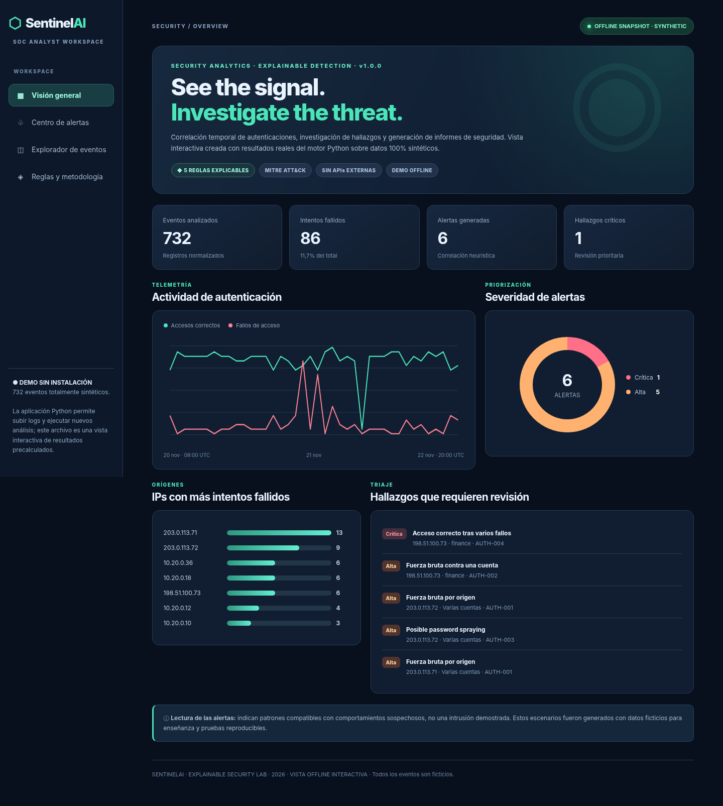

<div align="center">

# 🛡️ SentinelAI

**Explainable Threat Detection · SOC Dashboard · Experimental ML**

**Un laboratorio defensivo para analizar accesos, investigar patrones sospechosos y generar informes.**


</div>

---

## 👀 Vista previa



**Prueba inmediata:** descarga el repositorio y abre **`ABRIR-DEMO.html`** con doble clic. Funciona sin Python ni instalación: navegación, filtros, detalles de alertas y descarga JSON, todo con datos sintéticos precalculados. Para analizar tus propios logs, ejecuta la aplicación Python indicada más abajo.

> **Demo reproducible:** abre la interfaz con los datos sintéticos integrados y verás casos de fuerza bruta, password spraying y un acceso correcto después de varios fallos.

**Demo opcional en GitHub Pages:** el archivo `index.html` permite publicar esta vista en una web estática. Sigue [la guía de publicación](docs/PUBLICAR-EN-GITHUB.md).

## 🚀 Inicio rápido

Necesitas **Python 3.10 o superior** y un navegador actualizado. Compatible con Windows y WSL2.

**Windows — PowerShell**

```powershell
cd SentinelAI
py -m venv .venv
.\.venv\Scripts\Activate.ps1
python -m pip install -r requirements.txt
python -m streamlit run app.py
```

**WSL2 / Ubuntu**

```bash
cd SentinelAI
python3 -m venv .venv
source .venv/bin/activate
python -m pip install -r requirements.txt
python -m streamlit run app.py
```

Abre **http://localhost:8501**. No se requiere token, conexión a servicios de terceros ni instalación de máquinas virtuales.

> Si PowerShell impide activar scripts, puedes ejecutar directamente `\.venv\Scripts\python.exe -m pip install -r requirements.txt` y después `\.venv\Scripts\python.exe -m streamlit run app.py`, sin modificar la política de ejecución.

## ✨ Funcionalidades

| Función | Qué demuestra |
| --- | --- |
| Dashboard interactivo | Visualización de actividad, severidad y orígenes principales |
| 5 reglas correlacionadas | Ventanas temporales, umbrales, correlación y reducción de duplicados |
| MITRE ATT&CK | Clasificación y enlaces a técnicas conocidas |
| Centro de investigación | Evidencia asociada, cuenta/IP y recomendaciones de respuesta |
| CSV / JSONL / SSH auth.log | Ingesta, normalización, validación y errores explícitos |
| Isolation Forest (experimental) | Características por IP/15 min y anomalías no supervisadas |
| Informe HTML / CSV / JSON | Resultados exportables para comunicar hallazgos |
| CLI + CI | Uso automatizado, pruebas con pytest y GitHub Actions |

### Reglas disponibles

| Regla | Señal | MITRE | Severidad |
| --- | --- | --- | --- |
| `AUTH-001` | Muchos fallos desde una IP | [T1110.001](https://attack.mitre.org/techniques/T1110/001/) | Alta |
| `AUTH-002` | Muchos fallos contra la misma cuenta desde una IP | [T1110.001](https://attack.mitre.org/techniques/T1110/001/) | Alta |
| `AUTH-003` | Fallos contra muchas cuentas con pocas pruebas por cuenta | [T1110.003](https://attack.mitre.org/techniques/T1110/003/) | Alta |
| `AUTH-004` | Acceso correcto tras fallos recientes del mismo origen/cuenta | [T1078](https://attack.mitre.org/techniques/T1078/) | Crítica |
| `AUTH-005` | Acceso nocturno, indicador contextual (opcional) | [T1078](https://attack.mitre.org/techniques/T1078/) | Baja |

**Importante:** la asociación con MITRE describe una hipótesis compatible, **no confirma** que se haya ejecutado una técnica ni que exista compromiso. Los scores son orientativos, no probabilidades de ataque.

## 🧪 Ejemplo práctico

El dataset contiene **732 autenticaciones sintéticas** (20–22 noviembre 2026) con los siguientes patrones controlados:

- `203.0.113.71`: trece fallos seguidos contra `admin`.
- `203.0.113.72`: intentos fallidos contra nueve usuarios diferentes.
- `198.51.100.73`: seis fallos seguidos de una autenticación correcta de `finance`.
- `198.51.100.16`: un acceso en horario atípico (solo regla opcional).

Las direcciones `203.0.113.0/24` y `198.51.100.0/24` están reservadas para documentación; las IP `10.20.0.0/16` representan una red privada ficticia. **No se ha usado tráfico de terceros.**

También se incluyen `data/demo_auth.jsonl` y `data/demo_ssh.log` para probar otros formatos.

## 📄 Datos de entrada

Formato CSV recomendado:

```csv
timestamp,source_ip,username,outcome,service,country
2026-11-20T09:30:00Z,203.0.113.21,admin,failure,ssh,Unknown
2026-11-20T09:31:00Z,203.0.113.21,ana,success,vpn,ES
```

Obligatorias: `timestamp`, `source_ip`, `username`, `outcome`. Se aceptan alias habituales (`time`, `src_ip`, `user`, `status`) y valores normalizados de éxito/fracaso. Campos opcionales: `service`, `country`, `user_agent`, `raw_event`. Los timestamps sin offset se interpretan como UTC; las filas inválidas se descartan con contador visible.

**OpenSSH:** admite líneas de `sshd` de tipo `Failed password`, `Accepted password` y `Accepted publickey` del formato clásico `auth.log`. Como el syslog clásico no contiene año ni zona horaria, se debe elegir un año y se interpreta como **UTC**. Otros formatos SSH no se procesan ni se interpretan especulativamente.

Límite de tamaño: **10 MB** y **100.000 registros** por lote. Los análisis son locales al servidor que ejecuta Streamlit: si lo publicas en un servidor ajeno, no subas logs sensibles.

## 💻 Ejecución por línea de comandos

```bash
python -m sentinelai.cli --input data/demo_auth.csv --format csv \
  --output reports/detection.json --html reports/detection.html --csv reports/alerts.csv
```

En **PowerShell** (una sola línea):

```powershell
python -m sentinelai.cli --input data/demo_auth.csv --format csv --output reports/detection.json --html reports/detection.html --csv reports/alerts.csv
```

Para probar SSH: `python -m sentinelai.cli --input data/demo_ssh.log --format ssh --ssh-year 2026 --output reports/ssh.json`.

## 🧱 Arquitectura

```text
sentinelai/
├── index.html                # Entrada para GitHub Pages
├── ABRIR-DEMO.html           # Vista interactiva offline, sin instalación
├── app.py                    # Interfaz Streamlit (5 vistas)
├── sentinelai/
│   ├── parsers.py            # CSV / JSONL / SSH, normalización UTC
│   ├── detection.py          # Motor de reglas y correlación temporal
│   ├── ml.py                 # Isolation Forest (experimental)
│   ├── catalog.py            # Catálogo MITRE + respuesta sugerida
│   ├── reporting.py          # Informes con escaping y protección CSV
│   └── cli.py                # Automatización por terminal
├── data/                     # Datos ficticios, reproducibles
├── scripts/generate_demo.py  # Generador determinista
├── tests/                    # Tests unitarios e integración
├── assets/dashboard.png      # Captura real de la demo offline
└── .github/workflows/ci.yml  # CI para Python 3.10, 3.12, 3.13
```

## ✅ Pruebas

```bash
python -m pip install -r requirements-dev.txt
python -m pytest
```

Al subir cambios, GitHub Actions ejecutará los tests y el smoke test del CLI. Para reproducir los datos sintéticos, usa `python scripts/generate_demo.py`. Para reconstruir la demo HTML a partir de las detecciones, ejecuta `python scripts/build_demo_preview.py`.

## 🔬 Cómo funciona la detección

1. **Normalización:** ingesta de registros y conversión de fechas a UTC; identificación única de eventos.
2. **Correlación:** ventanas deslizantes para fallos por IP, cuenta e intentos entre cuentas; supresión temporal de repeticiones.
3. **Triaje:** alertas con referencia MITRE, severidad, explicación y evidencia trazable.
4. **ML opcional:** agrupa eventos por IP/15 minutos, extrae cinco características y aplica `IsolationForest` con semilla 42. El modelo se ajusta al lote analizado. Un valor atípico **no es** una amenaza validada.
5. **Exportación:** informes estáticos HTML, JSON y CSV. El HTML escapa los campos externos y el CSV protege contra fórmulas de hoja de cálculo.

### Limitaciones deliberadas

- **No es un SIEM de producción:** no hay streaming, autenticación multiusuario, alertas en directo, almacenamiento cifrado ni auditoría de acceso.
- **No hay clasificación validada:** ni métricas operativas de precisión/recall ni dataset etiquetado; se trata de heurísticas y exploración estadística.
- **Posibles falsos positivos:** actividad legítima puede activar las reglas. Los umbrales y el contexto importan.
- **MITRE no significa atribución:** una táctica plausible no equivale a evidencia de adversario.
- **Privacidad:** no se envían logs a APIs externas; los archivos se procesan donde esté alojada la aplicación. Se recomienda su uso local.
- **No actúa sobre sistemas:** sin escaneos, bloqueos IP ni explotación. Es análisis offline defensivo.

## 🗺️ Posibles extensiones

- Pruebas con datasets etiquetados (precisión, recall, falsos positivos).
- Perfiles de comportamiento por usuario e IP con baseline histórico.
- Correlación distribuida con múltiples orígenes y NAT.
- Exportación STIX, soporte Sigma y almacenamiento local.
- Docker, despliegue privado y autenticación para uso en equipo.

## 🎯 Qué contar en una entrevista

> «Desarrollé SentinelAI para analizar intentos de autenticación de forma explicable. Normalicé tres formatos de logs, implementé correlación temporal con reglas configurables, vinculé los resultados con MITRE ATT&CK, añadí trazabilidad de evidencias y una interfaz SOC. Incluí un experimento de Isolation Forest, documenté sus limitaciones y configuré pruebas y CI para asegurar reproducibilidad».

---

**Licencia MIT.** Proyecto educativo abierto para portfolio. No incluye datos reales ni endpoints externos.
